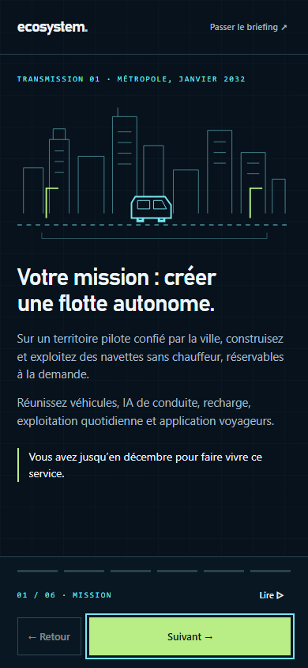
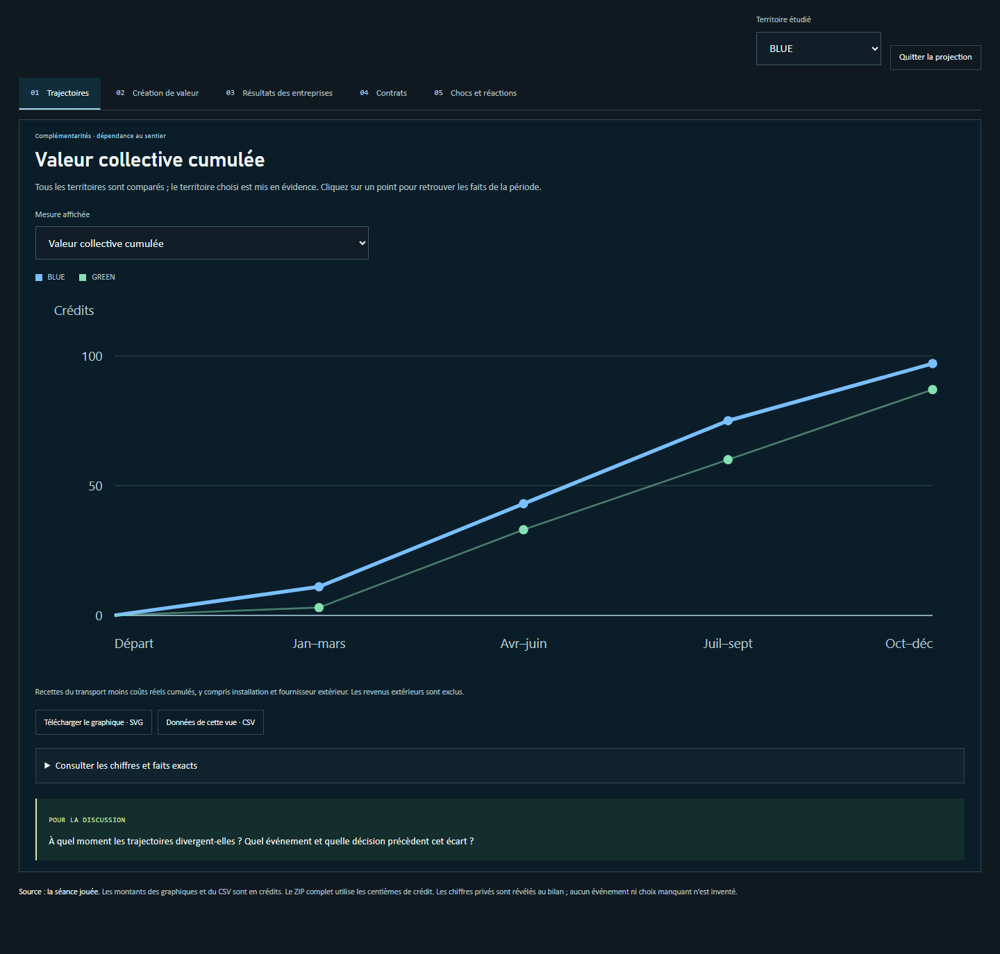

# ECOSYSTEM — notice d’utilisation

[English](NOTICE.md) · **Français** · [HTML imprimable](NOTICE.fr.html) · [Présentation du projet](README.fr.md)

Cette notice concerne la campagne narrative courante. Elle donne les instructions pratiques, sans fournir de stratégie gagnante. La référence économique complète est séparée et réservée à la préparation de l’enseignant.

**Enseignant :** installez et démarrez le jeu sur un ordinateur. **Participant :** ouvrez le QR ou le lien étudiant dans un navigateur ; aucune installation n’est nécessaire sur votre téléphone.

## 1. Préparer le matériel

| Élément | Besoin |
| --- | --- |
| Groupe | 10 à 30 participants ; un binôme peut partager une entreprise. |
| Durée | Environ 60 minutes, dont 15 minutes de débrief. |
| Ordinateur enseignant | Python 3.10 ou plus récent ; une version encore maintenue est recommandée. Tcl/Tk est nécessaire pour le lanceur de bureau. |
| Appareils participants | Téléphones, tablettes ou ordinateurs avec un navigateur récent et JavaScript activé. |
| Réseau | Wi-Fi/réseau local commun, ou tunnel public temporaire facultatif. |
| Matériel utile | Vidéoprojecteur, alimentation électrique et tables permettant la discussion. |

Le jeu local utilise la bibliothèque standard de Python et des fichiers web locaux. Il n’est pas nécessaire d’installer `requirements-dev.txt`, de créer un compte ou de compiler l’application. Internet sert au téléchargement initial et aux séances avec tunnel public.

Avant le premier cours, prévoyez l’installation et une courte répétition avec un téléphone. L’ordinateur enseignant doit rester allumé, sans mise en veille et connecté pendant toute la séance.

## 2. Installer et ouvrir le lanceur

1. Téléchargez le ZIP du dépôt ou une archive de distribution. Extrayez-la complètement dans un dossier accessible en écriture. Conservez les dossiers `eco`, `web` et `locales` à côté de `serveur.py`.
2. Installez Python avec Tcl/Tk. Sous Windows, vérifiez qu’une commande Python est disponible dans le terminal. Sous Linux, Tk peut être fourni séparément, par exemple dans le paquet `python3-tk` de votre distribution.
3. Sous Windows, double-cliquez sur **ouvrir-interface.bat**. Sous macOS/Linux, ouvrez un terminal dans le dossier du jeu puis lancez `python3 launcher.py`. `python launcher.py` convient également si cette commande utilise la bonne version.
4. Dans **Langue de la séance / Session language**, choisissez **Français** ou **English**. Le lanceur change immédiatement de langue.

Si le lanceur est indisponible, la méthode en console de la section 10 fonctionne sans Tk. Lancer le jeu depuis l’intérieur du ZIP ou depuis un dossier non modifiable peut empêcher les sauvegardes.

## 3. Régler la séance

| Réglage | Choix conseillé selon l’usage |
| --- | --- |
| Langue de la séance | S’applique à toute la campagne courante : participants, briefing et rapport hors connexion. Changez-la lorsque le serveur est arrêté. |
| Connexion | **Ce PC uniquement** pour répéter ; **Réseau local** pour un Wi-Fi commun ; **Adresse publique** pour un tunnel facultatif. |
| Nombre d’écosystèmes | **Automatique**, ou 2 à 6 territoires. Chaque territoire comporte cinq positions d’entreprise. Les participants supplémentaires partagent une entreprise ; les places vacantes sont signalées comme automatiques. |
| Port | Conservez 8000 sauf s’il est occupé. Après un changement, utilisez les nouveaux liens du lanceur. |
| Clé enseignant | Laissez ce champ vide pour générer une clé privée. Séparez le lien enseignant du lien étudiant. |
| Dossier des sauvegardes | Choisissez un dossier modifiable. Séparez les répétitions et les séances réelles. |
| Adresse IPv4 locale | Laissez-la généralement vide. Indiquez l’adresse réelle de l’ordinateur uniquement si la détection sélectionne la mauvaise interface réseau. |
| Au démarrage | **Créer une nouvelle partie** pour une nouvelle classe ; **Reprendre la dernière partie sauvegardée** pour continuer dans le dossier choisi. |

Cliquez sur **Démarrer le serveur**. Attendez le statut de fonctionnement, puis cliquez sur **Ouvrir le tableau de bord**. Le code de partie et le lien étudiant apparaissent à la fin du démarrage. Une nouvelle partie conserve les fichiers précédents et reçoit un nouveau code.

## 4. Connecter les participants

Projetez le QR du tableau de bord, ou copiez le lien étudiant depuis le lanceur. Les participants renseignent leur prénom, leur nom et le code de partie si ce dernier n’est pas déjà rempli. Pour une démonstration publique, utilisez des identités fictives.

Cliquez sur le QR du tableau pour l’agrandir, avec le lien étudiant et le code de partie. Revenez au tableau avec **Fermer**, la touche Échap ou un clic à l’extérieur de la fenêtre.

En réseau local, l’ordinateur et les appareils doivent pouvoir communiquer entre eux. Un Wi-Fi invité ou universitaire peut isoler les téléphones malgré un nom de réseau identique. Autorisez Python dans le pare-feu pour le réseau privé prévu, plutôt que de désactiver le pare-feu.

L’adresse `127.0.0.1` désigne l’appareil qui l’ouvre. Elle convient à une répétition sur un seul ordinateur ; un téléphone doit utiliser l’adresse locale de l’ordinateur enseignant ou celle du tunnel. Vérifiez toujours le véritable lien étudiant sur un téléphone avant le cours.

Contrôlez la liste des participants et les entreprises avant d’ouvrir janvier. Modifiez le nombre de territoires, réaffectez les participants ou redistribuez les rôles dans l’accueil. La répartition est figée après le début de l’année.

Le mode public nécessite `cloudflared`, installé séparément depuis les [téléchargements officiels de Cloudflare](https://developers.cloudflare.com/cloudflare-one/networks/connectors/cloudflare-tunnel/downloads/). Il n’est pas inclus dans le projet. L’adresse publique est temporaire : testez-la sur un téléphone avant de commencer. En cas d’échec, consultez les détails de connexion du lanceur et utilisez un réseau local commun si possible.

## 5. Consignes pour les participants

Après la connexion, lisez le briefing. Vous pouvez le mettre en pause, le revoir ou le passer ; le bouton **Brief** permet de le rouvrir. Le réglage de réduction des animations du navigateur active une lecture manuelle.



| Rubrique | Utilisation |
| --- | --- |
| **La situation** | Circonstances présentes, engagement d’installation, propositions et accord actif. |
| **Mon entreprise** | Informations privées, trésorerie disponible, frais, activité extérieure et transactions. |
| **La table** | Partenaires, engagements annoncés, messages publics et histoire du territoire. |

Votre entreprise reçoit 20 crédits une seule fois et cherche son meilleur résultat financier sur l’année. Discutez avec les partenaires et choisissez quelles informations privées révéler. Le résultat de votre entreprise et la valeur collective du transport sont deux mesures différentes. Un binôme partage une entreprise, un budget et une réponse.

Le bandeau **Votre équipe** reste en haut pendant le défilement et affiche le nom du territoire (BLUE, GREEN, etc.) dans sa couleur. Le rôle de votre entreprise (MOBI, AUTO, BRAIN, GRID ou FLEET) est indiqué séparément.

À chaque tour, MOBI propose des recettes et des investissements en crédits (au centième près). Les recettes attribuées doivent totaliser les recettes collectives à pleine capacité ; les contributions doivent financer exactement le devis. Un nouvel accord unanime est obligatoire à chaque tour. Sans accord, les recettes, frais d’exploitation et revenus extérieurs du tour sont nuls ; aucun contrat précédent n’est reconduit. Les investissements déjà payés restent acquis. Les incidents peuvent réduire les recettes et les versements convenus dans la même proportion.

Gardez l’onglet d’origine ouvert. Une actualisation de la même adresse dans le même navigateur retrouve normalement la session. Évitez d’effacer le stockage du navigateur ou de vous réinscrire plusieurs fois sous des noms différents. Le jeu ne dispose pas de comptes institutionnels ni de réinitialisation de mot de passe.

## 6. Conduire le calendrier

| Minutes | Calendrier | Action de l’enseignant |
| --- | --- | --- |
| 0–5 | Accueil | Connecter la classe, vérifier les rôles et laisser lire le briefing. |
| 5–13 | Janvier–mars | Ouvrir janvier ; laisser choisir les engagements et négocier. |
| 13–23 | Avril–juin | Clore le trimestre, puis laisser les groupes traiter leur situation locale. |
| 23–33 | Juillet–septembre | Avancer le calendrier et ouvrir une nouvelle période de décisions. |
| 33–40 | Octobre–décembre | Laisser la dernière fenêtre de décisions. |
| 40–45 | Bilan annuel | Clore décembre, comparer les résultats et télécharger les rapports. |
| 45–60 | Débrief | Reconstituer ensemble les décisions et leurs conséquences. |

**Clore cette date et avancer** règle les comptes de tous les territoires et ouvre la date suivante. Les groupes n’ont pas besoin de conclure un accord entre eux. Un territoire sans flotte peut négocier plus tard, sans rattraper le trimestre d’exploitation manqué.

Le chronomètre aide à animer la séance. Son expiration ne clôt pas le trimestre et ne valide pas une proposition. Sa pause arrête le décompte, mais ne bloque pas les décisions des participants. La barre d’espace démarre ou met en pause le chronomètre lorsque le curseur est hors d’un champ ou d’un bouton.

Une proposition non acceptée expire à la clôture : le tour rapporte zéro, sans reconduction du contrat précédent. Avancer la date conserve les investissements payés. Un binôme partage la même entreprise et la même décision.

## 7. Débriefer et télécharger les résultats

Après la clôture de décembre, ouvrez **Bilan annuel**, puis **Débrief & données**. Cinq vues accompagnent la discussion : trajectoires, création de valeur, résultats des entreprises, contrats, chocs et réactions. Rapprochez les résultats des circonstances réellement reçues avant de les interpréter.



| Téléchargement | Utilité |
| --- | --- |
| **SVG** | Insérer le graphique affiché dans des diapositives ou un rapport. |
| **CSV du graphique** | Lire les chiffres et faits de la vue ; les montants sont déjà en crédits. |
| **Rapport HTML hors connexion** | Conserver les cinq vues interactives sans serveur ni Internet. Les noms et jetons de connexion sont exclus. |
| **ZIP complet** | Analyser les métadonnées, le journal, les acteurs, décisions, contrats, tirages, transactions et états. Les montants sont en centièmes de crédit : diviser par 100. |

Les exports bruts conservent des noms de champs stables et la formulation enregistrée pour faciliter les comparaisons. Les messages libres sont conservés dans le journal et peuvent contenir les informations saisies par les participants. Vérifiez les fichiers avant de les partager. Le rapport hors connexion est un document d’analyse, pas une sauvegarde permettant de reprendre la partie.

## 8. Arrêter, sauvegarder et reprendre

Dans le lanceur, cliquez sur **Arrêter et sauvegarder** et attendez le statut d’arrêt avant de fermer la fenêtre. En console, utilisez Ctrl+C et attendez la confirmation de sauvegarde.

Le dossier sélectionné contient un fichier `partie-XXXX.json` par partie. Les sauvegardes comprennent l’état du jeu, les identités et les identifiants d’accès. Pour faire une copie de secours, arrêtez le serveur puis copiez tout le dossier dans un emplacement privé. Conservez les fichiers d’origine sans les modifier.

Pour reprendre, choisissez le même dossier et **Reprendre la dernière partie sauvegardée**. La partie la plus récente de ce dossier est sélectionnée. Conservez si possible la même adresse réseau et le même port : les identités du navigateur sont associées à cette adresse. Un nouveau nom de domaine de tunnel ne transfère pas automatiquement ces identités. Si un accès est perdu après l’accueil, prévenez l’enseignant plutôt que de créer des inscriptions en double.

Pour une nouvelle classe, choisissez **Créer une nouvelle partie**, de préférence dans un autre dossier. Les anciens fichiers sont conservés. L’application ne rembobine pas les décisions économiques ; utilisez une nouvelle répétition pour explorer un autre parcours.

## 9. Résoudre les problèmes courants

| Symptôme | Vérification |
| --- | --- |
| Python est introuvable | Installez la version requise puis rouvrez le terminal. Essayez `py -3 --version` sous Windows ou `python3 --version` sous macOS/Linux. |
| Tk ou le lanceur ne s’ouvre pas | Installez Python avec Tcl/Tk, ou utilisez la console. Un ordinateur sans interface graphique peut héberger le serveur sans lanceur. |
| Le port est occupé | Arrêtez le serveur lancé précédemment ou choisissez un autre port. Utilisez les liens associés au nouveau port. |
| Un téléphone ne se connecte pas | Vérifiez le mode réseau, la véritable adresse locale/publique, le pare-feu et l’isolation des appareils. `127.0.0.1` ne désigne pas l’enseignant depuis un téléphone. |
| L’interface tente de se reconnecter | Gardez l’onglet ouvert, rétablissez le réseau et vérifiez le serveur. Évitez les réinscriptions répétées. |
| La clé enseignant est invalide | Ouvrez le tableau depuis le bouton du lanceur actuel. Un ancien lien peut correspondre à une autre partie ou à une autre clé. |
| Une proposition ne peut pas être publiée | Vérifiez le total des crédits, le financement exact et les engagements nécessaires. |
| La date n’avance pas à la fin du temps | C’est normal : seul le bouton d’avancement de l’enseignant clôt la date. |
| Une erreur de sauvegarde apparaît | Vérifiez le droit d’écriture, l’espace disque et le dossier choisi. Attendez la confirmation avant de considérer une décision sauvegardée. Préservez un fichier illisible avant toute tentative de récupération. |
| Une ancienne interface reste visible | Actualisez, ou utilisez Ctrl+F5 après le redémarrage. Vérifiez la partie et la langue sélectionnées. |

## 10. Commandes en console

Exécutez ces commandes dans le dossier extrait du jeu. Remplacez `python` par `python3` si nécessaire.

Répétition française sur un ordinateur :

```sh
python serveur.py --host 127.0.0.1 --lang fr --nouvelle --donnees donnees-repetition
```

Séance en réseau local, avec quatre territoires :

```sh
python serveur.py --host 0.0.0.0 --lang fr --equipes 4 --nouvelle --donnees donnees-seance
```

Reprise de la dernière partie de ce dossier :

```sh
python serveur.py --host 0.0.0.0 --donnees donnees-seance
```

La langue enregistrée est conservée sauf si vous indiquez `--lang fr` ou `--lang en`. Options utiles : `--port 8001` pour changer de port ; `--ip VOTRE_IP_LOCALE` pour remplacer la détection ; `--tunnel` pour un tunnel public installé séparément. `--legacy` sélectionne explicitement l’ancien jeu français à manches, distinct de la campagne courante.

## 11. Données, distribution et aide complémentaire

Partagez le lien étudiant et gardez le lien enseignant privé. Le trafic HTTP local n’est pas chiffré. Un tunnel public expose un service temporaire ; il ne transforme pas ce serveur de classe en plateforme de production. Consultez [SECURITY.md](SECURITY.md) avant un déploiement plus large.

Ne publiez pas les sauvegardes, exports locaux, `.interface.json` ni le lien enseignant. Pour distribuer le code, lancez `python tools/build_release.py` et partagez `dist/ecosystem-source.zip`. Le code est sous [GPL-3.0-only](LICENSE) ; les outils tiers facultatifs sont installés séparément.

Le [README français](README.fr.md) présente le jeu. [CONTRIBUTING.md](CONTRIBUTING.md) décrit les vérifications techniques. La [référence enseignant](docs/regles-campagne.md) donne les règles économiques et les événements futurs : ne la projetez pas pendant le jeu.

Cette notice est fournie en Markdown, HTML hors connexion et PDF. Ouvrez `NOTICE.fr.html` dans un navigateur pour la lire sans serveur ; **Imprimer / Enregistrer en PDF** permet d’obtenir une copie papier. Les versions anglaises sont `NOTICE.md`, `NOTICE.html` et `NOTICE.pdf`.

Chaque joueur peut publier les recettes qu’il demande, l’investissement collectif maximal qu’il propose et ses raisons. Une discussion publique permet d’interpeller un partenaire, de proposer une concession et d’expliquer une acceptation ou un refus. Les demandes ne remplacent pas le consentement au contrat publié. Les informations privées ne sont révélées que par leur propriétaire.
