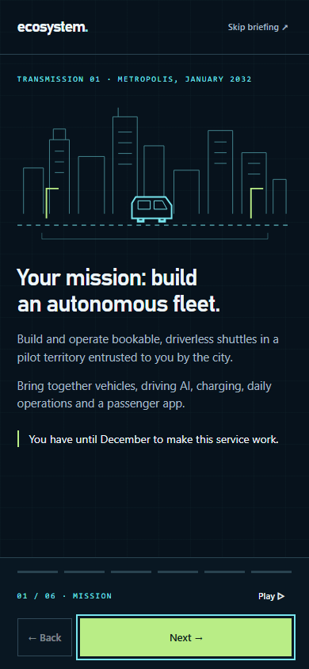
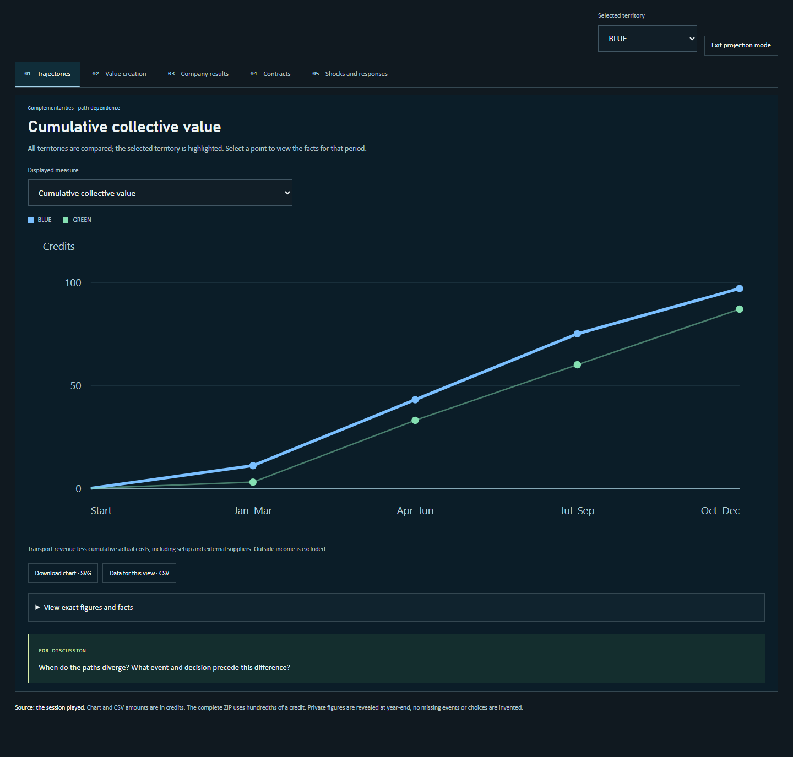

# ECOSYSTEM — user guide

**English** · [Français](NOTICE.fr.md) · [Printable HTML](NOTICE.html) · [Project presentation](README.md)

This guide covers the current narrative campaign. It contains practical instructions, not a winning strategy. The complete economic reference is separate and intended for instructors.

**Instructor:** install and start the game on one computer. **Participant:** open the QR/student link in a browser; no installation is needed on your phone.

## 1. What to prepare

| Item | Requirement |
| --- | --- |
| Class | 10–30 participants; a pair can share one company. |
| Time | About 60 minutes, including 15 minutes of debrief. |
| Instructor computer | Python 3.10 or later; a currently supported version is recommended. Tcl/Tk is needed for the desktop launcher. |
| Participant devices | Phones, tablets or computers with a modern browser and JavaScript enabled. |
| Classroom network | A shared Wi-Fi/LAN, or an optional temporary public tunnel. |
| Useful equipment | Projector, power supply and tables where partners can discuss. |

Local play uses Python's standard library and local web assets. You do not need to install `requirements-dev.txt`, create an account or build the application. Internet access is required only for downloading the project/tools and for public-tunnel sessions.

Before the first class, allow time for installation and a short rehearsal with one phone. Keep the instructor computer awake and connected for the whole session.

## 2. Install and open the launcher

1. Download the repository ZIP or a prepared source release. Extract it completely into a folder you can write to. Keep `eco`, `web` and `locales` beside `serveur.py`.
2. Install Python with Tcl/Tk. On Windows, make sure a Python command is available in your terminal. On Linux, Tk may be a separate distribution package such as `python3-tk`.
3. On Windows, double-click **ouvrir-interface.bat**. On macOS/Linux, open a terminal in the game folder and run `python3 launcher.py`. `python launcher.py` also works when `python` selects the required interpreter.
4. Under **Langue de la séance / Session language**, choose **English** or **Français**. Changing the selection updates the launcher immediately.

If the desktop launcher is unavailable, the console method in section 10 works without Tk. Running directly inside a ZIP or from a read-only folder can prevent saves.

## 3. Configure a session

| Setting | What to choose |
| --- | --- |
| Session language | Applies to the whole current campaign, including players, briefing and the offline report. Change it with the server stopped. |
| Connection | **This computer only** for rehearsal; **Local network** for a shared Wi-Fi; **Public address** for an optional tunnel. |
| Number of ecosystems | **Automatic**, or 2–6 territories. Each has five company positions. Extra participants share companies; vacant seats are labelled as automated. |
| Port | Keep 8000 unless it is occupied. If you change it, use the new links generated by the launcher. |
| Instructor key | Leave blank to generate a private key. Keep the instructor URL separate from the student link. |
| Save folder | Choose a writable folder. Use different folders for rehearsals and real classes. |
| Local IPv4 | Usually leave blank. Supply the computer's actual LAN address only if automatic detection chooses the wrong interface. |
| At startup | **Create a new game** for a new class; **Resume the most recent saved game** to continue work in the selected folder. |

Select **Start the server**. Wait for the running status, then select **Open the dashboard**. The game code and student link appear when startup completes. New games keep previous save files and receive a new code.

## 4. Connect participants

On the dashboard, project the QR code or copy the student link from the launcher. Participants enter their first and last names and the game code if it is not already filled in. For public demonstrations, use fictional identities.

Click the dashboard QR to open a large projection with the student link and game code. Use **Close**, Escape or a click outside the panel to return to the dashboard.

For local-network play, the computer and participant devices must be on a network that allows devices to communicate. A guest/campus network may isolate phones even when they show the same Wi-Fi name. Allow Python through the firewall for the intended private network rather than disabling the firewall.

The address `127.0.0.1` means the device opening it. It is appropriate for a one-computer rehearsal; a phone needs the instructor computer's LAN address or a tunnel URL. Always test the actual student link on a phone before class.

Check the participant roster and company assignments before opening January. Adjust the number of territories, reassign participants or redistribute roles in the lobby. Assignments are frozen once the year begins.

The public-tunnel mode requires `cloudflared`, installed separately from [Cloudflare's official downloads](https://developers.cloudflare.com/cloudflare-one/networks/connectors/cloudflare-tunnel/downloads/). It is not bundled with the project. The generated public address is temporary; check it on a phone before starting. If the tunnel fails, inspect the launcher's connection details and use a shared LAN if available.

## 5. Participant instructions

After joining, read the briefing. It can be paused, revisited or skipped; the **Brief** button reopens it. Browser reduced-motion settings enable manual reading.



| Tab | What you use it for |
| --- | --- |
| **The situation** | Current circumstances, your setup choice, proposals and the active agreement. |
| **My company** | Private information, available cash, costs, outside activity and transactions. |
| **The table** | Partners, announced commitments, public messages and territory history. |

Your company receives 20 credits once and seeks its best financial result over the year. Discuss with your partners; decide what private information to share. Your company result and collective transport value are different measures. A pair shares one company, one budget and one response.

The **Your team** strip stays at the top while you scroll, showing your territory name (BLUE, GREEN, etc.) in its colour. Your company role (MOBI, AUTO, BRAIN, GRID or FLEET) is displayed separately.

Each quarter, MOBI proposes revenue amounts and investments in credits (to the nearest hundredth). Allocated revenue must equal the collective revenue at full capacity; contributions must match the investment quote exactly. A fresh unanimous agreement is required every quarter. Without agreement, revenue, operating charges and outside income for the quarter are zero; no previous contract is carried forward. Paid investments remain in place. Incidents can reduce receipts and agreed payouts by the same factor.

Keep the original browser tab open. Refreshing the same address in the same browser normally restores its session. Avoid clearing browser storage or joining repeatedly under new names. The game has no institutional account or password-reset system.

## 6. Run the calendar

| Minutes | Calendar | Instructor action |
| --- | --- | --- |
| 0–5 | Welcome | Connect the class, check roles and allow briefing time. |
| 5–13 | January–March | Open January; let companies choose commitments and negotiate. |
| 13–23 | April–June | Close the quarter, then let groups respond to their local situation. |
| 23–33 | July–September | Advance the calendar and allow further decisions. |
| 33–40 | October–December | Give the class its final decision window. |
| 40–45 | Annual results | Close December, compare results and download reports. |
| 45–60 | Debrief | Reconstruct decisions and consequences together. |

**Close this date and advance** settles accounts for every territory and opens the next date. Groups do not need to reach an agreement with other groups. A territory without a fleet can negotiate later, but cannot recover a missed operating quarter.

The timer is a facilitation aid. Its expiry does not close the quarter or approve a proposal. Pausing it pauses the clock; it does not lock participant decisions. The space bar starts/pauses the clock when focus is outside a form control.

An unaccepted proposal expires at closure: the quarter earns zero, with no previous contract carried forward. Advancing the date preserves paid investments. A pair shares one company and one decision.

## 7. Debrief and download results

After closing December, open **Annual results** and **Debrief & data**. Five views support the discussion: trajectories, value creation, company results, contracts, and shocks/responses. Compare results with each territory's actual circumstances before drawing conclusions.



| Download | Purpose |
| --- | --- |
| **SVG** | Export the displayed chart for slides or reports. |
| **Chart CSV** | Read the figures/facts displayed in that view; monetary amounts are already in credits. |
| **Offline HTML report** | Keep all five interactive views without a server or Internet connection. Participant names and access tokens are excluded. |
| **Complete ZIP** | Analyse metadata, the journal, actors, decisions, contracts, draws, transactions and states. Monetary amounts are hundredths of a credit: divide by 100. |

Raw exports retain stable field names and original recorded wording for comparability. Free-text game messages are recorded in the journal and may contain information participants chose to enter. Check files before sharing them. The offline report is an analysis document, not a resumable game save.

## 8. Stop, save and resume

In the launcher, select **Stop and save** and wait for the stopped status before closing the window. In console mode, press Ctrl+C and wait for the save confirmation.

The selected folder contains one `partie-XXXX.json` file per game. Saves include game state, participant identities and access credentials. To make a backup, stop the server and copy the entire save folder to a private location. Keep the original files unchanged.

To resume, select the same save folder and **Resume the most recent saved game**. The latest game in that folder is selected. Use the same network address and port when practical; participant browser identities are stored for that address. A newly generated tunnel hostname does not automatically transfer browser identity. If access is lost after the lobby, involve the instructor rather than creating duplicate entries.

To start a different class, select **Create a new game**, preferably in a separate folder. This preserves earlier files. The application does not rewind economic decisions; use a new rehearsal game to try a different path.

## 9. Troubleshooting

| Symptom | What to check |
| --- | --- |
| Python is not found | Install the required version; reopen the terminal. Try `py -3 --version` on Windows or `python3 --version` on macOS/Linux. |
| Tk/desktop launcher fails | Install Python with Tcl/Tk, or use console mode. A headless computer can run the server without the launcher. |
| The port is occupied | Stop the server you launched earlier, or choose another port. Use the links for the new port. |
| A phone cannot connect | Confirm network mode, actual LAN/tunnel URL, firewall permission and device isolation. `127.0.0.1` will not reach the instructor from a phone. |
| The interface shows reconnection | Keep the tab open; restore the network and confirm the server is still running. Avoid repeatedly joining again. |
| The instructor key is invalid | Open the dashboard from the current launcher's button. Old teacher URLs can refer to a different game/key. |
| The group cannot publish | Check the credit total, exact funding and required company commitments. |
| The date did not advance when time expired | This is expected. Only the instructor's advance control closes the date. |
| A save error appears | Check write permission, free disk space and the selected folder. Do not assume a decision is saved until confirmed. Preserve any unreadable save before attempting recovery. |
| Players still see an older interface | Refresh, or use Ctrl+F5 after restarting the server. Check that the correct saved game and language were selected. |

## 10. Console commands

Run these commands from the extracted game folder. Substitute `python3` if needed.

One-computer English rehearsal:

```sh
python serveur.py --host 127.0.0.1 --lang en --nouvelle --donnees donnees-rehearsal
```

Local-network session with four territories:

```sh
python serveur.py --host 0.0.0.0 --lang en --equipes 4 --nouvelle --donnees donnees-class
```

Resume the latest game in that folder:

```sh
python serveur.py --host 0.0.0.0 --donnees donnees-class
```

The saved language is retained unless you provide `--lang fr` or `--lang en`. Optional flags: `--port 8001` for another port; `--ip YOUR_LAN_IP` to override address detection; `--tunnel` for a separately installed public tunnel. `--legacy` explicitly selects the archived French round-based game, not the current campaign.

## 11. Privacy, distribution and further help

Use the student URL for participants and keep the instructor link private. Local HTTP traffic is unencrypted. A public tunnel exposes a temporary service; it does not turn the classroom server into a production hosting platform. Read [SECURITY.md](SECURITY.md) before broader deployment.

Do not publish saves, local exports, `.interface.json` or the instructor link. For source distribution, run `python tools/build_release.py` and share `dist/ecosystem-source.zip`. The source is licensed under [GPL-3.0-only](LICENSE); optional third-party tools are installed separately.

The [project README](README.md) presents the game. [CONTRIBUTING.md](CONTRIBUTING.md) describes development checks. The [instructor reference](docs/regles-campagne.en.md) gives full economics and future-event details: do not project it during play.

This guide is included as Markdown, offline HTML and PDF. Open `NOTICE.html` in a browser to read it without the game server; **Print / Save as PDF** produces a paper copy. The French equivalents are `NOTICE.fr.md`, `NOTICE.fr.html` and `NOTICE.fr.pdf`.

Each player can publish requested revenue, a maximum proposed collective investment and their reasons. A public discussion lets players address a partner, offer a concession and explain acceptance or refusal. These requests do not replace consent to the published agreement. Private information is disclosed only by its owner.
