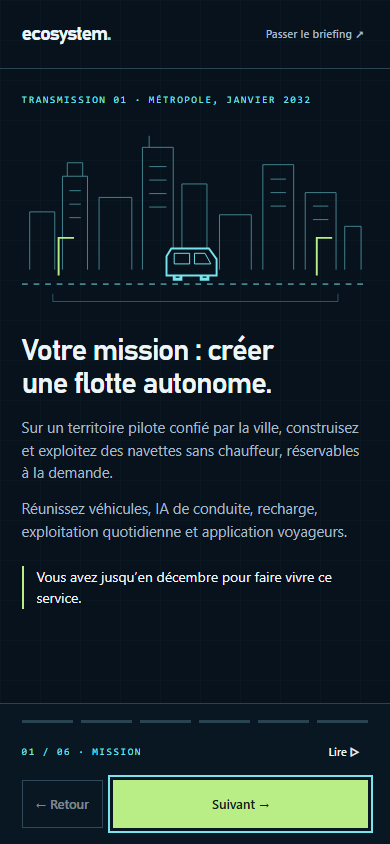
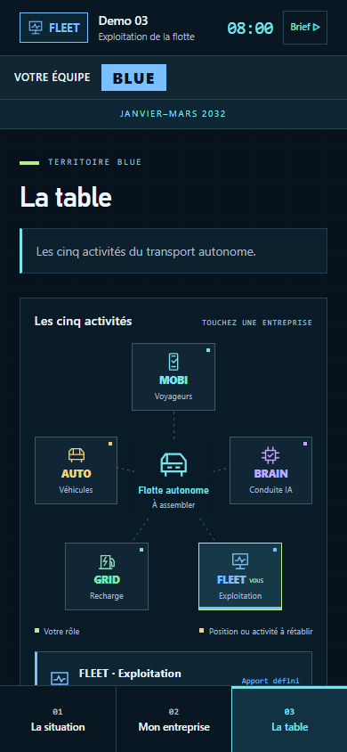
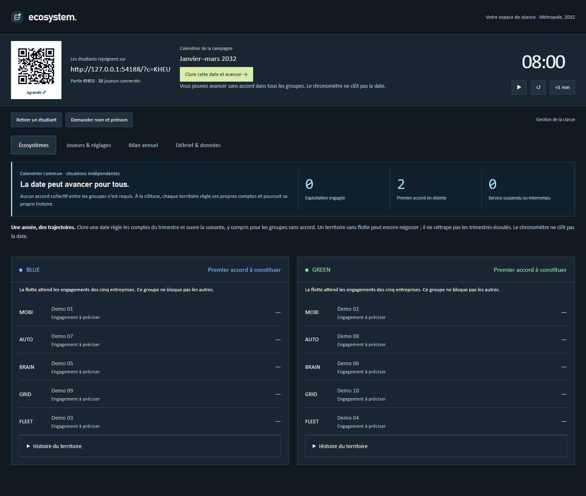
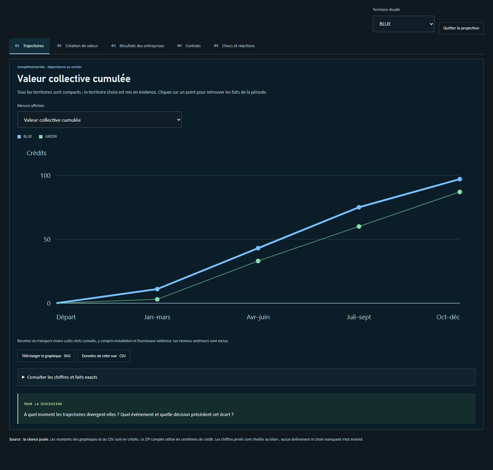

# ECOSYSTEM

**Cinq entreprises négocient pour lancer et exploiter un service de navettes autonomes.**

ECOSYSTEM est un serious game pédagogique sur les **écosystèmes d’affaires, la négociation et la création de valeur**. En 2032, chaque équipe a une année pour mettre sur pied un service de transport. Les joueurs incarnent des entreprises aux activités complémentaires, avec des coûts privés et leurs propres objectifs financiers.

**Environ 60 minutes, débrief compris · 10 à 30 participants · Français ou anglais · GPL-3.0-only**

[English presentation](README.md) · [Lancer le jeu](#lancer-le-jeu) · [Notice d’utilisation](NOTICE.fr.md)

<table>
  <tr>
    <th scope="col">Le briefing de mission</th>
    <th scope="col">La table de négociation</th>
  </tr>
  <tr>
    <td><a href="docs/screenshots/briefing-fr.png"></a></td>
    <td><a href="docs/screenshots/table-fr.png"></a></td>
  </tr>
</table>

*Captures d’une séance de démonstration avec des participants fictifs. Cliquez sur une image pour l’agrandir.*

## Lancer le jeu

L’ordinateur enseignant héberge la partie. Les participants jouent dans leur navigateur, sur téléphone, tablette ou ordinateur. Sur un réseau local, aucun compte ni paquet Python supplémentaire n’est nécessaire.

1. Sur GitHub, choisissez **Code → Download ZIP** et extrayez toute l’archive.
2. Installez **Python 3.10 ou plus récent avec Tcl/Tk** pour utiliser le lanceur graphique.
3. Sous Windows, ouvrez **`ouvrir-interface.bat`**. Sous macOS ou Linux, ouvrez un terminal dans le dossier du jeu et lancez `python3 launcher.py`.
4. Choisissez la langue de la séance et le mode **Réseau local**. Démarrez le serveur et ouvrez le tableau de bord enseignant.
5. Connectez les participants au même réseau et partagez le **lien étudiant ou le QR code**. Gardez le lien enseignant privé.

<details>
<summary>Faire une répétition sur un seul ordinateur</summary>

Exécutez cette commande dans le dossier extrait. Elle utilise un dossier de sauvegarde distinct et limite les connexions à votre ordinateur. Tcl/Tk est facultatif pour ce mode.

```sh
python serveur.py --host 127.0.0.1 --lang fr --nouvelle --donnees donnees-demo
```

Utilisez `python3` si nécessaire. Ouvrez les liens enseignant et étudiant affichés dans le terminal. Pour réunir une classe depuis plusieurs réseaux, consultez la configuration du tunnel facultatif dans la [notice](NOTICE.fr.md).

</details>

## Déroulement d’une séance

| Étape | Ce qui se passe |
| --- | --- |
| **Prendre un rôle** | Chaque territoire réunit cinq entreprises. **MOBI** gère l’application voyageurs et coordonne les propositions, **AUTO** fournit les véhicules, **BRAIN** la conduite autonome, **GRID** les infrastructures de recharge et **FLEET** l’exploitation du service. |
| **Négocier un accord** | Chaque entreprise consulte son dossier privé, discute ses conditions et vote sur la proposition de MOBI. Les joueurs décident comment financer les investissements et partager les recettes du transport. Chaque trimestre exige un accord unanime. |
| **S’adapter sur quatre trimestres** | L’enseignant avance le calendrier commun. Chaque territoire rencontre ses propres événements et peut avoir à renégocier, investir ou remplacer un partenaire. Les investissements déjà payés pèsent sur la suite. Sans accord, le trimestre ne génère ni revenus ni frais d’exploitation. |
| **Comparer les résultats** | En fin d’année, la classe compare le résultat financier de chaque entreprise à la valeur collective créée par le service. Les deux joueurs d’un binôme partagent une entreprise, un budget et une décision. |

<details>
<summary>Voir le tableau de bord enseignant et le QR code</summary>



[Voir le QR code agrandi](docs/screenshots/join-fr.png) · [Voir le dossier privé d’une entreprise](docs/screenshots/company-fr.png)

</details>

## Débrief

La classe compare les trajectoires des territoires et revient sur les décisions, accords et incidents qui ont précédé les écarts. Cinq vues interactives présentent les trajectoires, la valeur collective, les résultats par entreprise, les contrats et les réactions aux chocs.

[](docs/screenshots/debrief-fr.png)

L’enseignant peut exporter les graphiques en SVG, les tableaux en CSV, un rapport HTML interactif hors connexion et les données complètes de la séance. Le graphique ci-dessus illustre une partie de démonstration.

## Documentation

- [Notice d’utilisation](NOTICE.fr.md) · [PDF prêt à imprimer](NOTICE.fr.pdf) · [HTML imprimable hors connexion](NOTICE.fr.html)
- [Règles économiques et événements réservés à l’enseignant](docs/regles-campagne.md) · [Guide du débrief](docs/debrief-guide.md)
- [Contribuer et lancer les tests](CONTRIBUTING.md) · [Réseau et données de séance](SECURITY.md)
- [Licence](LICENSE) · [Documentation en anglais](README.md)

Le mode historique à manches est accessible avec `--legacy` et conserve son interface française. Consultez le [guide archivé](README-manches.md).

### Préparer l’archive du code

Lancez `python tools/build_release.py` pour générer `dist/ecosystem-source.zip` et sa somme SHA-256. L’archive réunit le code, la documentation et les captures de démonstration. Les parties locales, identifiants, préférences et exécutables de tunnel restent dans le dossier de travail.
