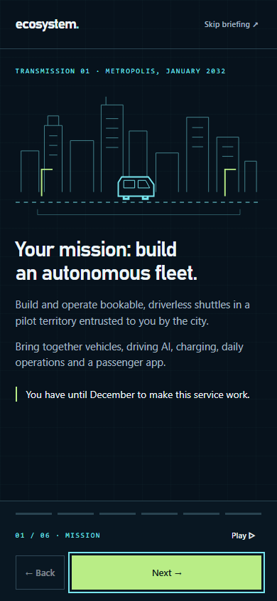
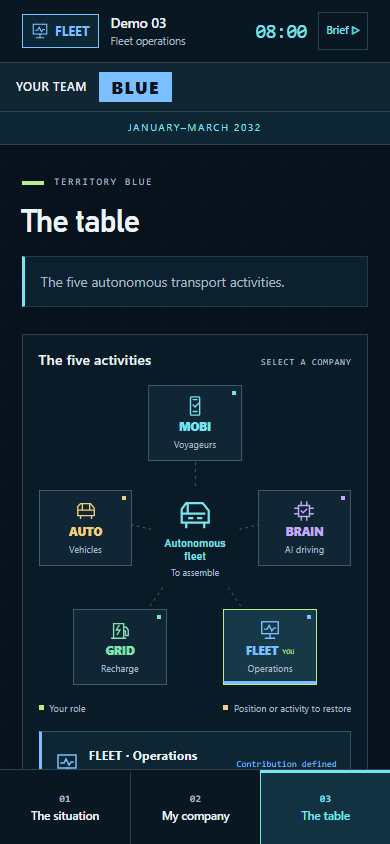
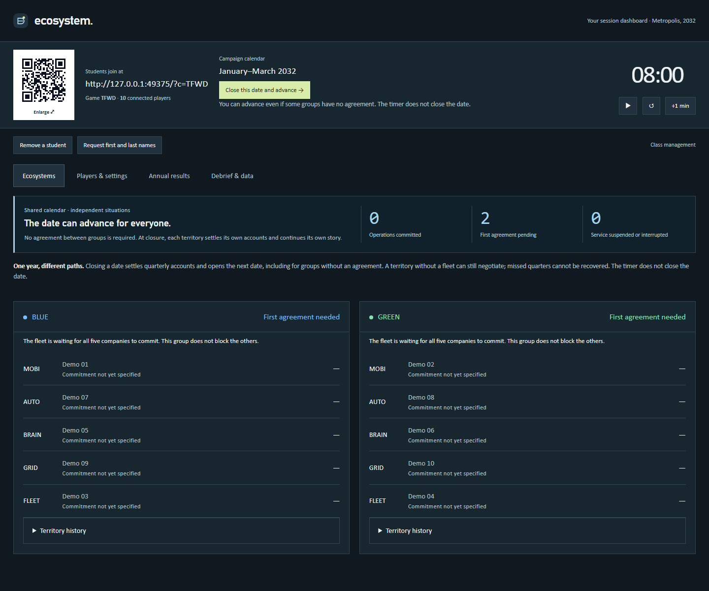
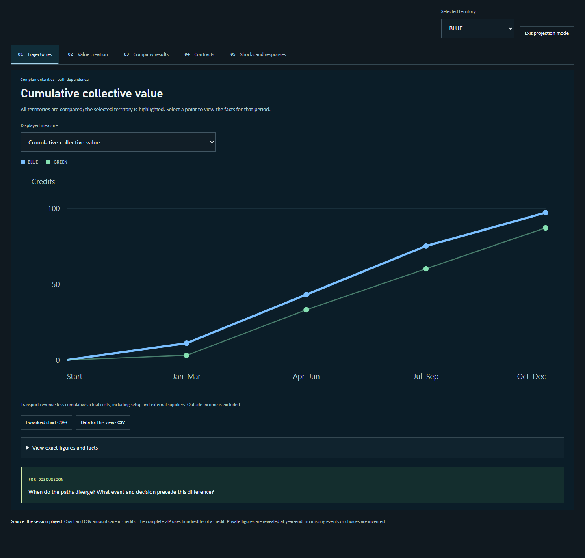

# ECOSYSTEM

**Five companies negotiate to launch and run an autonomous shuttle service.**

ECOSYSTEM is a classroom serious game about **business ecosystems, negotiation and value creation**. In 2032, each team has a year to build a transport service. Players represent companies with complementary capabilities, private costs and their own financial objectives.

**About 60 minutes, including debrief · 10–30 participants · English or French · GPL-3.0-only**

[Présentation en français](README.fr.md) · [Quick start](#quick-start) · [Facilitator guide](NOTICE.md)

<table>
  <tr>
    <th scope="col">The mission briefing</th>
    <th scope="col">The negotiation table</th>
  </tr>
  <tr>
    <td><a href="docs/screenshots/briefing-en.png"></a></td>
    <td><a href="docs/screenshots/table-en.png"></a></td>
  </tr>
</table>

*Screenshots from a demo session with fictional participants. Click an image to enlarge it.*

## Quick start

One instructor computer hosts the game. Participants join from a browser on a phone, tablet or computer. A local session requires no accounts or Python packages.

1. Select **Code → Download ZIP** on GitHub and extract the entire archive.
2. Install **Python 3.10+ with Tcl/Tk** for the desktop launcher.
3. On Windows, open **`ouvrir-interface.bat`**. On macOS or Linux, open a terminal in the game folder and run `python3 launcher.py`.
4. Select the session language and choose **Local network**. Start the server and open the instructor dashboard.
5. Connect participants to the same network and share the **student link or QR code**. Keep the instructor link private.

<details>
<summary>Rehearse on one computer from a terminal</summary>

Run this command in the extracted folder. It uses a separate save folder and only accepts connections from your computer. It works without Tcl/Tk.

```sh
python serveur.py --host 127.0.0.1 --lang en --nouvelle --donnees donnees-demo
```

Use `python3` if required. Open the instructor and student links printed in the terminal. To connect a class across different networks, see the optional tunnel setup in the [facilitator guide](NOTICE.md).

</details>

## How a session works

| Step | What happens |
| --- | --- |
| **Take a role** | Each territory has five companies. **MOBI** manages the passenger app and coordinates proposals, **AUTO** supplies vehicles, **BRAIN** supplies autonomous driving, **GRID** provides charging infrastructure, and **FLEET** operates the service. |
| **Negotiate an agreement** | Each company consults its private ledger, discusses its terms and votes on MOBI’s proposal. Players decide how to fund investment and share transport revenue. An agreement requires unanimous consent each quarter. |
| **Adapt over four quarters** | The instructor advances the shared calendar. Each territory faces its own events and may need to renegotiate, invest or replace a partner. Investments already paid affect later decisions. A quarter without an agreement generates no income or operating costs. |
| **Compare outcomes** | At year-end the class compares each company’s financial result with the collective value created by the service. A pair sharing a company makes one decision and shares its budget. |

<details>
<summary>See the instructor dashboard and student QR code</summary>



[See the enlarged QR projection](docs/screenshots/join-en.png) · [See the private company ledger](docs/screenshots/company-en.png)

</details>

## Debrief

Compare territories and trace differences back to specific decisions, contracts and incidents. Five interactive views cover trajectories, collective value, company results, agreements, and shocks and responses.

[](docs/screenshots/debrief-en.png)

The instructor can export SVG charts, CSV tables, a standalone interactive HTML report, and the full session data. The chart above illustrates one demo run.

## Documentation

- [Facilitator guide](NOTICE.md) · [Print-ready PDF](NOTICE.pdf) · [Printable offline HTML](NOTICE.html)
- [Full economic rules and events for instructors](docs/regles-campagne.en.md) · [Debrief guide in French](docs/debrief-guide.md)
- [Contributing and running checks](CONTRIBUTING.md) · [Network and session data](SECURITY.md)
- [License](LICENSE) · [French documentation](README.fr.md)

The original round-based game is available with `--legacy` and uses its original French interface. See the [archived guide](README-manches.md).

### Package the source

Run `python tools/build_release.py` to build `dist/ecosystem-source.zip` and its SHA-256 checksum. The archive includes the code, documentation and demo screenshots. Local sessions, credentials, launcher preferences and tunnel executables stay in the working folder.
