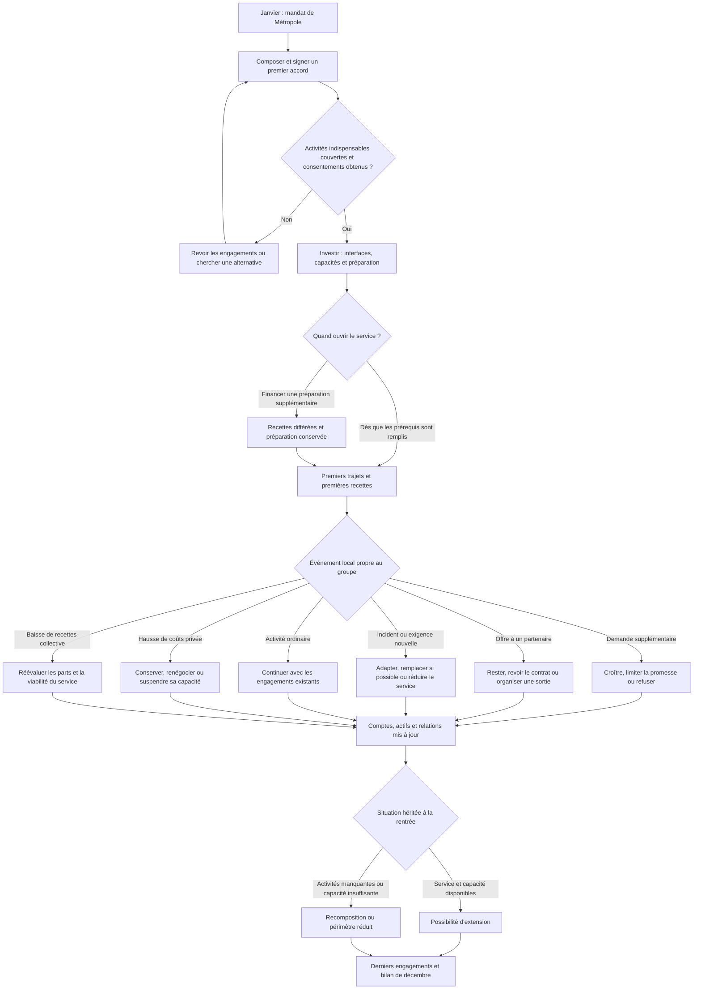

# ECOSYSTEM — une année, des trajectoires

Architecture de la campagne narrative désormais jouable par défaut. Le moteur courant est `eco/campaign.py` ; ses paramètres chiffrés sont détaillés dans [docs/regles-campagne.md](docs/regles-campagne.md). Format : 60 minutes, dont 15 minutes de débrief, cinq entreprises par groupe, téléphones individuels et pilotage enseignant. Les anciennes manches restent accessibles uniquement dans le mode historique explicite.

## 1. Le changement de principe

Les étudiants développent un même service pendant une année fictive. Une décision modifie durablement leur situation : un investissement reste payé, un contrat continue de produire ses effets, un retard fait manquer une recette et une interface spécifique rend une substitution plus difficile.

Chaque transition doit pouvoir être racontée ainsi : **« Vous aviez choisi X ; dans les circonstances Y, cela vous permet maintenant Z, ou vous impose ce coût. »** Le récit distingue les conséquences des choix des événements réellement extérieurs.

L'arbre de décision est, techniquement, un graphe d'états. Plusieurs chemins peuvent rejoindre une même situation avec des actifs, une trésorerie et des droits différents. Rejoindre un nœud n'efface pas le passé. Il n'y a plus d'échec pédagogique obligatoire : une coalition peut fonctionner dès son premier accord.

## 2. Le mandat qui ouvre l'histoire

> Métropole, janvier 2032. La ville ouvre plusieurs territoires pilotes aux navettes autonomes. Votre consortium dispose d'une année pour installer un service viable. La ville attend des trajets fiables, accessibles et disponibles à la demande. Vous dirigez une entreprise indépendante. Votre réussite dépend des partenaires, mais vos intérêts ne se confondent pas avec les leurs.

Les groupes commencent avec les mêmes ressources et possibilités de base. Les trajectoires divergent ensuite par les décisions et les événements locaux. Plusieurs territoires peuvent réussir ; ils ne se disputent pas artificiellement une seule licence.

La fin de l'année est connue, pour permettre de juger l'intérêt d'un investissement. Les événements, leurs résultats et l'arbre futur restent inconnus des participants.

## 3. La mémoire de l'écosystème

| État conservé | Conséquences ultérieures |
| --- | --- |
| Trésorerie de chaque entreprise | Finance les dépenses suivantes ; aucune nouvelle dotation gratuite entre deux scènes. |
| Contrat actif | Parts de revenu, coûts, durée, droits d'accès et restrictions restent valables jusqu'à révision consentie ou échéance annoncée. |
| Actifs et capacités | Véhicules, dépôt, interfaces, préparation et capacité d'exploitation ne sont pas rachetés à chaque épisode. |
| Structure des dépendances | Qui remplit chaque activité, échange avec qui, détient quels droits et peut réellement remplacer quel partenaire. |
| Engagements spécifiques | Les dépenses irrécupérables et restrictions consenties conditionnent une sortie ou une recomposition. |
| Service rendu | Trajets réalisés, interruptions et promesses tenues affectent les recettes et les commandes ultérieures. |
| Options extérieures | Une offre reçue, son échéance et les engagements de mobilité modifient le pouvoir de négociation. |
| Informations reçues | Le moteur sait qui connaissait quelle information au moment d'une décision, sans tout afficher aux partenaires. |

La fiabilité renvoie à des services et interruptions observables. On n'ajoute pas une jauge de « confiance » récompensant les réponses attendues par le concepteur.

## 4. L'arbre narratif principal

Une version séparée du diagramme est disponible dans [docs/arbre-narratif.mmd](docs/arbre-narratif.mmd).



Les retours en négociation sont bornés par la date limite. Sans accord à l'échéance, le démarrage est différé ; les actifs et les coûts engagés restent. Une fenêtre ultérieure permet une recomposition. Pas de boucle infinie, de dépenses sans consentement ni de remise à zéro.

L'extension est une possibilité et non une récompense automatique. Un groupe peut rester petit et viable. Un autre peut beaucoup croître tout en devenant très dépendant et peu rentable.

## 5. Les décisions qui fabriquent les branches

| Situation narrative | Décision effective | Trace durable |
| --- | --- | --- |
| « La ville attend votre premier accord. » | Négocier les parts du revenu et les contributions ; chaque entreprise consent à ses engagements. | Le contrat signé s'applique aux recettes suivantes. Un désaccord retarde le service, sans annuler des dépenses déjà autorisées. |
| « Les équipes techniques attendent un cahier des charges. » | Choisir des interfaces spécifiques ou une standardisation documentée, et leur financement. | Performance, coût initial, droits d'accès et facilité de substitution diffèrent. Les interfaces deviennent des actifs. |
| « Le pilote peut ouvrir. » | Démarrer dès que les prérequis sont satisfaits ou financer une préparation supplémentaire. | Recettes plus précoces, ou recette différée et préparation réutilisable. La préparation ne protège pas de tous les événements. |
| « Un client veut davantage de trajets. » | Ajouter de la capacité, partager cette recette, limiter la promesse ou décliner. | Une commande acceptée engage le service. La capacité coûte et persiste ; une promesse non tenue peut affecter la demande suivante. |
| « Une autre activité attire BRAIN. » | Rester, demander un avenant ou sortir selon les droits négociés. | Une option extérieure devient crédible. Une exclusivité antérieure conserve son effet ; une sortie peut interrompre une activité indispensable. |
| « Une activité n'est plus assurée. » | Réparer, mobiliser une réserve, remplacer si possible, réduire ou arrêter le service. | Les alternatives dépendent des interfaces, des droits et des actifs déjà installés. L'entreprise remplacée conserve son histoire. |
| « La rentrée ouvre une possibilité d'extension. » | Maintenir le périmètre, investir ou recomposer le partenariat. | Les recettes acquises peuvent financer l'étape suivante ; les anciens contrats conditionnent la nouvelle négociation. |

MOBI rédige les propositions ; les partenaires consentent à leurs propres obligations. Une nouvelle version rend caducs les consentements à l'ancienne. Les fonds sont dépensés à l'entrée en vigueur, sauf investissement distinct déjà autorisé et journalisé.

## 6. Une prise réelle pour chaque rôle

| Entreprise | Décision propre | Dépendance à négocier |
| --- | --- | --- |
| MOBI | Proposer le contrat et le périmètre commercial. | Réunir les engagements sans pouvoir commander les autres. |
| AUTO | Engager des véhicules et une adaptation spécifique ou réutilisable. | Faire financer une capacité parfois difficile à redéployer. |
| BRAIN | Consentir des droits d'usage de l'IA et d'éventuelles restrictions de mobilité. | Arbitrer revenu, contrôle technologique et débouchés extérieurs. |
| GRID | Engager la capacité de recharge et ses conditions d'accès. | Financer une infrastructure indispensable sans garantie de demande supplémentaire. |
| FLEET | Engager l'exploitation et les moyens de préparation/continuité. | Faire reconnaître le coût des opérations et des engagements de service. |

Les choix d'architecture ne modifient pas unilatéralement les droits d'un partenaire. Les obligations impliquant plusieurs entreprises passent par un accord explicite.

À un instant donné, chaque participant traite au maximum une décision propre et un engagement collectif. Les paramètres d'une activité apparaissent lorsqu'elle est concernée ; pas cinq tableaux complets au démarrage.

Une entreprise qui sort garde son identité, ses actifs et ses revenus acquis. À chaque fenêtre suivante, son étudiant peut maintenir son engagement extérieur ou proposer un retour avec ses propres conditions, dont l'acceptation dépend du consortium et des contrats déjà actifs. Une prestation indépendante est possible seulement si ses capacités et ses droits le permettent. Il ne récupère pas rétroactivement les revenus du projet. Le prototype limite à une position remplacée par groupe pour garder ce parcours jouable en classe.

## 7. Des aléas différents, des causes identifiables

BLUE peut subir une indisponibilité d'infrastructure pendant que GREEN reçoit une demande supplémentaire et RED poursuit une activité ordinaire. Le moteur ne déclenche pas une crise pour pénaliser le groupe le mieux classé.

Trois niveaux sont séparés :

1. **Circonstance extérieure** : audit, demande locale, indisponibilité externe ou offre d'un autre client. Le tirage de base ne dépend pas du score.
2. **Exposition héritée** : les conséquences dépendent des activités, des capacités, des droits et de la préparation. Un même audit ne coûte pas la même chose à deux systèmes différents.
3. **Réaction choisie** : compensation, réparation, remplacement, réduction ou extension ; ses effets persistent ensuite.

Une décision peut aussi modifier une probabilité, mais ce mécanisme est alors distinct et documenté : par exemple, la préparation réduit le risque d'interruption à la mise en service. Il ne faut pas confondre ce risque conditionnel avec le tirage d'un événement extérieur.

Les règles `campaign-2.1` proposent trois occasions d'événement local : avril, juillet et octobre. Familles : demande, mobilité d'un partenaire, hausse privée des coûts, baisse collective des recettes, capacité/infrastructure, certification, activité ordinaire. Une flotte active ne peut pas connaître deux périodes ordinaires consécutives. Probabilités et montants sont ceux de [la calibration courante](docs/regles-campagne.md), distincts de l'ancien jeu.

Les occasions sont attachées au calendrier économique commun, pas à la vitesse des clics. Les familles incompatibles sont écartées avant le tirage unique, puis les poids sont normalisés. Les candidats retenus et exclus, leurs motifs et la valeur tirée sont enregistrés. Un groupe toujours sans flotte ou déjà interrompu conserve sa difficulté présente. La réalisation dépend donc des circonstances et de l'état hérité ; cette sélection doit être prise en compte dans l'analyse des différences entre groupes.

### Reproduction des histoires

Une graine est conservée par séance. Chaque tirage possède une clé stable : groupe, date et canal. Une décision supplémentaire d'un groupe ne décale pas les tirages des autres. Une reprise ou un double clic ne provoque pas un nouveau tirage.

Pour chaque occasion, conserver les candidats, probabilités, valeur tirée, intensité, conditions d'éligibilité, état antérieur et version des règles. Un événement imposé par l'enseignant est marqué comme imposé.

Une relecture de débrief pourra appliquer une autre architecture au même événement extérieur et à la même intensité. Elle montre un effet mécanique du modèle, en maintenant les autres décisions fixes ; elle ne prétend pas reproduire les réactions que les personnes auraient eues dans une autre histoire.

## 8. Trois trajectoires possibles

**BLUE** finance une intégration spécifique et ouvre tôt. Les premières recettes arrivent. BRAIN a conservé sa liberté de mobilité ; une offre extérieure lui parvient. Le groupe doit choisir entre compensation et substitution coûteuse. Les recettes initiales peuvent financer la continuité, mais les interfaces limitent ses alternatives. Aucun échec n'est garanti.

**GREEN** finance des interfaces documentées et ouvre plus tard. Une indisponibilité d'infrastructure survient. Le remplacement est plus accessible, mais les dépenses initiales et les recettes manquées restent à financer. Le groupe peut être résilient tout en finissant avec moins de trésorerie que BLUE.

**RED** garde de la capacité disponible au lieu de tout engager. Une demande supplémentaire arrive ; il peut l'accepter rapidement si ses partenaires s'accordent sur les conditions. En activité ordinaire, cette réserve aurait pu rester coûteuse et inutilisée.

Ces histoires ne sont pas affectées d'avance aux groupes. Elles illustrent les interactions possibles entre décisions, circonstances et états hérités.

## 9. Une économie cumulative

- Une dotation initiale unique par entreprise. Aucun rechargement gratuit entre scènes.
- Des coûts d'installation distincts des coûts d'exploitation et de modification. Une même dépense n'est pas débitée deux fois.
- Des parts contractuelles exprimées en pourcentage du revenu disponible, conservées jusqu'à révision consentie ou échéance.
- Quatre dates de règlement trimestrielles communes. Ce sont des dates comptables, pas quatre nouveaux projets. Chaque décision prend effet avant le règlement annoncé.
- L'activité extérieure rapporte uniquement sur les périodes où l'entreprise n'est pas engagée dans une activité incompatible. Pas de double rémunération de la même capacité.
- Une sortie n'annule ni les recettes acquises, ni les coûts irrécupérables, ni les contributions déjà dues.
- « Ouvrir tôt » signifie au premier moment où les prérequis sont remplis, jamais contourner une certification obligatoire.
- Toute dépense précise payeur, montant, date et financement disponible. Un prêt éventuel exigerait une règle explicite ; aucune trésorerie négative silencieuse.

**Résultat de l'entreprise** : variation de trésorerie depuis son entrée, en séparant revenus du projet, activité extérieure et transferts. Les actifs et capacités restant en fin d'année sont montrés séparément. Pour le prototype, pas de valeur terminale fictive récompensant un investissement inutilisé ; l'horizon est annoncé dès le début.

**Valeur collective du projet** : recettes de clients réalisées moins coûts réels d'installation, d'exploitation et d'adaptation. Un virement entre partenaires ne crée pas de valeur collective. Activités extérieures et subventions sont identifiées séparément des recettes commerciales.

La fin distingue ainsi cash, valeur collective, service rendu et ressources restantes. Les montants de l'ancien jeu ne peuvent pas simplement être additionnés : ils ont été équilibrés pour des remises à zéro. Les nouveaux paramètres doivent être simulés sur l'année entière.

## 10. Un rythme commun, des chemins locaux

| Temps réel indicatif | Expérience des groupes |
| --- | --- |
| 0–5 min | Brief animé, mandat et dossiers privés. |
| 5–13 min | Premier accord et engagements initiaux. |
| 13–21 min | Mise en place, préparation et démarrage. |
| 21–31 min | Événements locaux et décisions de réaction. |
| 31–40 min | Opportunités et recompositions héritées ; dernière fenêtre de décision. |
| 40–45 min | Dernière exploitation et bilan annuel. |
| 45–60 min | Débrief à partir des trajectoires enregistrées. |

L'enseignant pilote les dates limites et les règlements, tandis que les groupes peuvent être dans des nœuds différents. Un groupe qui termine vite n'obtient pas un trimestre supplémentaire. Sans nouvel accord, le contrat précédent continue s'il est encore valide ; sinon, le moteur constate l'activité non couverte et ses conséquences, sans réinitialisation.

## 11. Ce que voit le participant

Conserver l'esthétique futuriste, le briefing et les trois rubriques : **La situation**, **Mon entreprise**, **La table**.

La situation affiche un message narratif court, les faits antérieurs connus qui l'expliquent, et les options actuellement possibles avec leurs engagements immédiats. Exemple : « Vos interfaces sont spécifiques à BRAIN. Le remplacement proposé nécessite une adaptation ; voici son coût et son délai connus. »

Le participant revoit son histoire passée, pas l'arbre futur. Son dossier contient trésorerie, actifs, obligations et informations privées. La table montre les contrats publiés et les échanges. Les votes restent privés jusqu'à leur clôture.

Une option indisponible indique une contrainte présente : droit d'accès absent, capacité déjà engagée ou financement manquant. L'interface ne révèle pas un événement caché pour justifier son absence.

## 12. Les données à concevoir dès maintenant

La donnée centrale est la trajectoire horodatée, pas le classement final. Le journal métier est complet, sans limite de 200 messages comme le journal technique actuel ; les rafraîchissements de page ne sont pas des décisions.

Trois unités restent distinctes : participant, entreprise et position dans l'écosystème. Un binôme représente une entreprise et une décision. Un substitut ne réutilise pas l'identifiant de l'entreprise remplacée. L'export d'analyse est pseudonymisé ; la correspondance avec les noms reste séparée.

| Ensemble | Champs essentiels |
| --- | --- |
| Identité et ordre | `schema_version`, `rules_version`, `session_id`, `event_id`, `sequence`, `occurred_at`, `economic_date`, `ecosystem_id`. |
| Récit | `node_id`, `visit_id`, `decision_id`, `event_type`, liens vers les événements ou contrats causaux. |
| Choix | Entreprise agissante, proposition/version, options offertes et contraintes, choix, consentements, date de soumission et date d'effet. |
| Information | Référence au dossier réellement visible lors du choix, distinct de l'état complet connu du moteur. |
| Transition | États avant et après, contrat actif, effets appliqués et motifs des restrictions. |
| Aléatoire | Occasion, canal, candidats, probabilités, valeur tirée, intensité et origine aléatoire ou imposée. |
| Comptabilité | Transaction, payeur, bénéficiaire ou compte de coût réel, montant, nature économique, date et décision causale. |

Le choix et l'état résultant sont écrits durablement dans la même opération avant confirmation au client. Un identifiant de requête empêche qu'une reconnexion rejoue une dépense. Une correction enseignant ajoute un événement compensatoire au lieu de réécrire le passé.

### Exports de fin de séance

Un dossier par séance, importable dans un tableur, R ou Python :

| Fichier | Une ligne représente |
| --- | --- |
| `journal.jsonl` | Un événement métier complet, source de reconstruction. |
| `acteurs.csv` | Une entreprise stable ; les positions successives sont datées. |
| `decisions.csv` | Une décision engagée ou un refus, avec options disponibles et information visible. Les tentatives invalides sont distinguées. |
| `contrats.csv` | Une entreprise dans une version de contrat : part, coûts, accès, restrictions et dates d'effet. |
| `tirages.csv` | Une occasion de tirage, y compris activité ordinaire, inéligibilité et intervention enseignant. |
| `transactions.csv` | Un mouvement comptable attribuable à une cause, distinguant transfert et coût/recette réels. |
| `etats.csv` | Un état de groupe à une décision ou un règlement : service, capacités, dépendances et métriques financières. |

La fiche de séance conserve paramètres, versions des règles, calendrier et graines. Les exports utilisent des identifiants analytiques, pas des jetons de connexion. Les exemples synthétiques de conception restent séparés des données réelles du cours.

## 13. Des questions théoriques reliées à des traces

| Question de débrief | Données à rapprocher | Notion discutée |
| --- | --- | --- |
| Pourquoi le service n'a-t-il pas démarré alors que les technologies existaient ? | Activités nécessaires, consentements, accès et activité restée non couverte. | Alignement et complémentarités. |
| Comment l'accord est-il devenu acceptable ? | Versions du contrat, refus, contributions et moments des consentements. | Orchestration sans autorité hiérarchique. |
| Qui a créé la recette et qui l'a captée ? | Recettes clients, coûts réels et transferts, rapprochés des contributions. | Création et capture de valeur. |
| Quand un acteur a-t-il obtenu une meilleure part ? | Offre extérieure reçue avant l'avenant, mobilité, alternatives réellement utilisables et évolution du contrat. | Options extérieures, dépendance et pouvoir de négociation. |
| Pourquoi un remplacement coûte-t-il davantage ici ? | Interfaces et droits antérieurs au choc, coût d'adaptation, délai et service interrompu. | Spécificité, substituabilité et verrouillage. |
| L'acteur limitant est-il resté le même ? | Position empêchant le service ou l'extension à plusieurs dates, capacités et clauses correspondantes. | Déplacement des goulots d'étranglement. |
| Pourquoi une stratégie a-t-elle réussi dans un territoire et échoué ailleurs ? | État antérieur, événement, intensité et réaction ; hasard distingué de l'exposition choisie. | Risques d'interdépendance et effets de trajectoire. |

La lecture par activités, acteurs, positions et liens vient d'[Adner, 2017](https://doi.org/10.1177/0149206316678451). L'articulation entre complémentarités, modularité et coordination d'organisations indépendantes s'appuie sur [Jacobides, Cennamo et Gawer, 2018](https://iris.unibocconi.it/retrieve/handle/11565/4013728/90809/SMJ_Ecosystem%20Theory.pdf). L'attention à la position du problème dans les interdépendances est cohérente avec [Adner et Kapoor, 2010](https://faculty.wharton.upenn.edu/wp-content/uploads/2012/07/Adner-Kapoor-SMJ-2010.pdf). Les cartes et règles chiffrées seront des choix de simulation ; ces articles ne les prescrivent pas.

On ne déduit pas automatiquement la confiance d'un vote ni l'opportunisme d'une demande élevée. Une intention changée peut refléter une nouvelle information. Une justification privée, courte et facultative peut être recueillie juste après une décision importante, avant ses conséquences.

Avec quelques groupes, on peut documenter des mécanismes et comparer des trajectoires ; le meilleur score brut ne prouve pas qu'une architecture est supérieure. La diversité des événements impose de lire l'exposition et la chronologie. Les contrefactuels du moteur sont présentés comme des simulations, distinctes d'un effet causal mesuré chez les étudiants.

### Restitution à projeter

1. Une ligne de temps par groupe : décision → état hérité → événement → réponse → résultat.
2. Les trésoreries des entreprises et la valeur collective, avec événements annotés.
3. L'évolution des parts contractuelles, alignée avec offres extérieures et changements de partenaires.
4. La carte des dépendances au départ et à la fin, pour identifier qui est devenu indispensable et pourquoi.
5. Deux comparaisons ciblées : un type d'événement selon les états antérieurs ; un gain individuel face au résultat du service.

## 14. Le changement de moteur nécessaire

La refonte remplace `phase globale → round → score isolé`. Elle ne consiste pas à renommer les phases.

```text
Séance : calendrier commun, versions, graines et participants
Écosystème : nœud courant, contrats, activités, capacités, droits et service
Entreprise : identité, trésorerie, actifs, position et engagements persistants
Nœud narratif : texte, conditions d'entrée, choix, consentements, échéance et transitions
Événements : occasions datées, éligibilité, tirages reproductibles et effets
Comptabilité : mouvements, coûts, recettes et règlements datés
Journal : événements complets, reconstruction et exports d'analyse
```

Le téléphone reçoit le nœud de son groupe et les seules informations autorisées. Le tableau enseignant suit plusieurs trajectoires et pilote le calendrier. La publication d'un vote et la clôture d'un engagement sont distinctes du changement de date.

Les anciennes sauvegardes restent identifiées comme version « manches ». Une conversion silencieuse inventerait des actifs et engagements qui n'ont pas été joués. Une campagne narrative utilise un nouveau format et un nouveau code de sauvegarde ; un dossier dédié peut l'isoler des archives. Les anciennes parties restent consultables dans leur version.

## 15. Critères de validation de la campagne

- Des choix différents ouvrent des possibilités différentes. Un nœud commun ne réinitialise pas les états.
- Les contrats, actifs et résultats antérieurs sont conservés ; un refus initial ne crée pas un échec obligatoire.
- Chaque branche garde une décision utile pour chaque étudiant, y compris en cas de sortie de son entreprise.
- À graines et historiques identiques, la trajectoire est reproductible ; reprise et ordre de connexion ne changent pas les tirages.
- Les comptes empêchent recettes rétroactives, dépenses doublées et cumul incompatible d'activités.
- L'export reconstruit la trajectoire et se rapproche exactement des soldes finaux.
- Les simulations d'équilibrage couvrent activité ordinaire, opportunités et crises ; elles recherchent les stratégies dominantes partout, les impasses et les pénuries systématiques.
- Aucun score ou tirage n'est ajusté en cours de partie pour produire la « bonne démonstration » théorique.

La première calibration est implémentée et comparée sur 320 campagnes synthétiques. Les tests vérifient la persistance, les consentements, les aléas, les comptes et les exports ; le contrôle navigateur joue plusieurs branches avec vingt participants puis reprend leur sauvegarde. Une séance pilote permettra d'affiner les paramètres en publiant une nouvelle version des règles. Le dispositif de données est déjà intégré au moteur courant.
